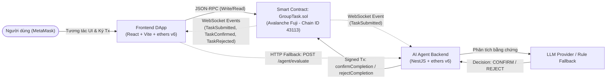
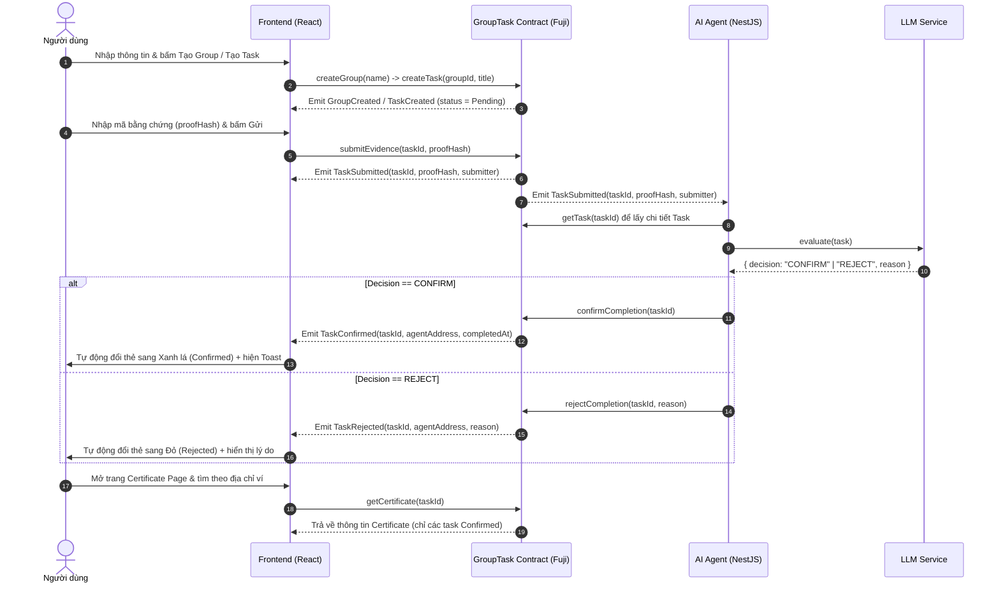

# Kiến trúc Hệ thống — ProofWork

## 1. Sơ đồ Kiến trúc Tổng quan

---

## 2. Luồng Hoạt động (Sequence Flow)

---

## 3. Vai trò của 3 Thành phần

| Thành phần | Công nghệ | Vai trò chính |
| :--- | :--- | :--- |
| **1. Smart Contract (`contracts/`)** | Solidity `^0.8.24`, Hardhat, OpenZeppelin `AccessControl` | Lưu trữ toàn bộ trạng thái on-chain (`Group`, `Task`, `Certificate`), kiểm soát phân quyền (`AGENT_ROLE`, `DEFAULT_ADMIN_ROLE`), và phát sự kiện (`Events`) khi trạng thái thay đổi. |
| **2. Frontend (`frontend/`)** | React 18, Vite, TypeScript, `ethers.js` v6 | Cung cấp giao diện 3 màn hình (Create, Confirm, Certificate), kết nối ví MetaMask trên mạng Avalanche Fuji (`43113`), gửi giao dịch của người dùng và lắng nghe sự kiện on-chain theo thời gian thực. |
| **3. AI Agent (`agent/`)** | NestJS, TypeScript, `ethers.js` v6 (`WebSocketProvider`) | Lắng nghe sự kiện `TaskSubmitted` từ Smart Contract qua WebSocket, đánh giá bằng chứng (`proofHash`) bằng LLM (kèm cơ chế fallback rule-based), và dùng ví có quyền `AGENT_ROLE` để gọi `confirmCompletion` hoặc `rejectCompletion` ghi kết quả lên on-chain. |

---

## 4. Quy tắc Giao tiếp & Đồng bộ Trạng thái

1. **Làm sao Frontend biết Agent đã duyệt xong?**
   - Frontend **không** gọi polling liên tục vào Agent, mà đăng ký lắng nghe trực tiếp sự kiện on-chain (`contract.on("TaskConfirmed", ...)` và `contract.on("TaskRejected", ...)`) thông qua `eventService.ts`.
   - Ngay khi giao dịch của Agent được xác nhận trên Avalanche Fuji, Smart Contract emit `TaskConfirmed` hoặc `TaskRejected`. Frontend bắt được sự kiện này, tự động cập nhật UI của thẻ Task tương ứng và bật `EventToast` mà người dùng không cần tải lại trang (F5).
2. **Làm sao Agent biết có bằng chứng mới cần duyệt?**
   - Agent kết nối tới Avalanche Fuji qua `WebSocketProvider` và lắng nghe sự kiện `TaskSubmitted(uint256 indexed taskId, bytes32 proofHash, address indexed submitter)`.
3. **Cơ chế Dự phòng (Fallback khi mất kết nối WebSocket):**
   - Trong trường hợp kết nối WebSocket bị gián đoạn khi demo, Frontend hoặc người vận hành có thể gọi trực tiếp HTTP API `POST /agent/evaluate` kèm header `x-demo-secret` và `{ "taskId": number }` để kích hoạt Agent đọc dữ liệu on-chain và thực thi duyệt task ngay lập tức.
4. **Chia sẻ ABI & Địa chỉ Contract (`shared/`):**
   - Sau khi compile và deploy ở `contracts/`, script `export.ts` xuất ABI ra `shared/abi/GroupTask.json` và địa chỉ contract ra `shared/addresses.json`. Cả `frontend/` và `agent/` đều đọc từ `shared/` để đảm bảo khớp tuyệt đối chữ ký hàm và sự kiện.
