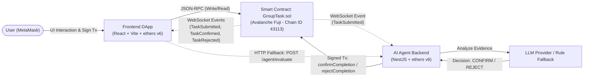
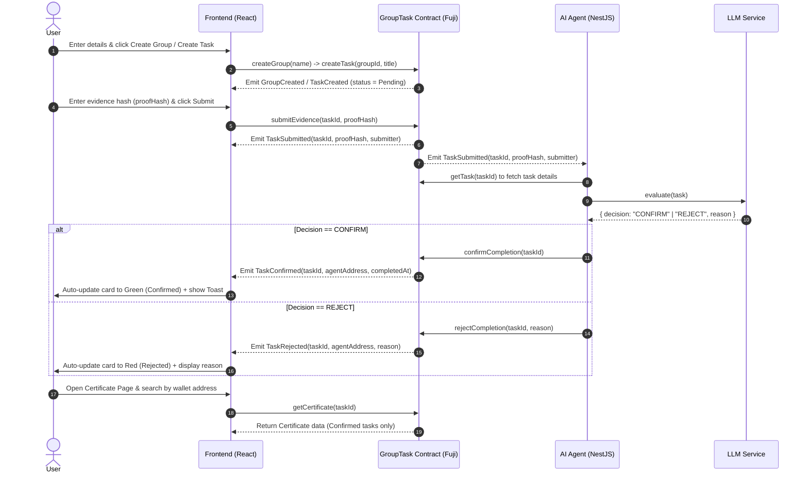

# System Architecture — ProofWork

## 1. High-Level Architecture Diagram

---

## 2. End-to-End Sequence Flow

---

## 3. Roles of the 3 Core Components

| Component | Tech Stack | Primary Responsibility |
| :--- | :--- | :--- |
| **1. Smart Contract (`contracts/`)** | Solidity `^0.8.24`, Hardhat, OpenZeppelin `AccessControl` | Stores all on-chain state (`Group`, `Task`, `Certificate`), enforces role-based access control (`AGENT_ROLE`, `DEFAULT_ADMIN_ROLE`), and emits events upon state transitions. |
| **2. Frontend (`frontend/`)** | React 18, Vite, TypeScript, `ethers.js` v6 | Provides the 3-screen web interface (Create, Confirm, Certificate), connects to MetaMask on Avalanche Fuji (`43113`), sends user transactions, and listens to real-time on-chain events. |
| **3. AI Agent (`agent/`)** | NestJS, TypeScript, `ethers.js` v6 (`WebSocketProvider`) | Listens to `TaskSubmitted` events from the Smart Contract via WebSocket, evaluates evidence (`proofHash`) using an LLM (with a deterministic rule-based fallback), and signs `confirmCompletion` or `rejectCompletion` transactions using the `AGENT_ROLE` wallet. |

---

## 4. Communication & State Synchronization Rules

1. **How does the Frontend know when the Agent has finished evaluating?**
   - The Frontend does **not** poll the Agent backend continuously; instead, it subscribes directly to on-chain events (`contract.on("TaskConfirmed", ...)` and `contract.on("TaskRejected", ...)`) via `eventService.ts`.
   - As soon as the Agent's transaction is confirmed on Avalanche Fuji, the Smart Contract emits `TaskConfirmed` or `TaskRejected`. The Frontend catches the event, immediately updates the corresponding Task Card UI, and triggers an `EventToast` notification without requiring a page reload (F5).
2. **How does the Agent detect newly submitted evidence?**
   - The Agent connects to Avalanche Fuji via `WebSocketProvider` and listens for `TaskSubmitted(uint256 indexed taskId, bytes32 proofHash, address indexed submitter)`.
3. **Fallback Mechanism (When WebSocket disconnects):**
   - If the WebSocket connection drops during a live demo, the Frontend or operator can invoke the HTTP endpoint `POST /agent/evaluate` with the `x-demo-secret` header and `{ "taskId": number }` payload to trigger the Agent to fetch on-chain state and execute evaluation immediately.
4. **Shared ABI & Contract Addresses (`shared/`):**
   - After compiling and deploying in `contracts/`, the `export.ts` script exports the ABI to `shared/abi/GroupTask.json` and deployed addresses to `shared/addresses.json`. Both `frontend/` and `agent/` import from `shared/` to guarantee 100% signature and event compatibility.
